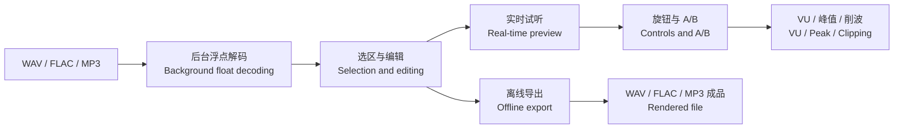

# ADD A VALVE

<p align="center">
  
</p>

一款面向 Windows 的单轨音频染色与轻量编辑工具。通过谐波饱和、音色塑形、4 倍过采样和干湿混合，为音频增加可调的电子管风格色彩。

*A Windows desktop application for single-track valve-style audio colouration and lightweight editing. It combines harmonic saturation, tone shaping, 4× oversampling and dry/wet blending to add adjustable valve-inspired colour to audio.*

> “胆味”是主观音色描述。本项目采用算法化谐波与滤波处理，并不宣称精确复刻某款真实电子管电路。
>
> *“Valve sound” is a subjective description. This project uses algorithmic harmonic and filter processing; it does not claim to reproduce any specific valve circuit exactly.*

**导航 / Navigation：[下载 / Download](#下载--download) · [使用 / Usage](#使用流程--usage) · [构建 / Build](#从源码构建--building-from-source) · [技术细节 / Technical Details](#技术细节--technical-details) · [许可 / Licensing](#第三方组件与许可--third-party-components-and-licensing)**

## 下载 | Download

前往 [Releases](https://github.com/Zhou1019-1/sound-effect-ADD-A-VALVE/releases/latest) 下载 `ADD-A-VALVE-0.1.1-Windows-x64.zip`。

*Download `ADD-A-VALVE-0.1.1-Windows-x64.zip` from [Releases](https://github.com/Zhou1019-1/sound-effect-ADD-A-VALVE/releases/latest).*

1. 完整解压 ZIP。<br>*Extract the entire ZIP archive.*
2. 运行 `ADD A VALVE.exe`。<br>*Run `ADD A VALVE.exe`.*
3. 保持 `lame.exe` 与主程序在同一目录，否则无法导出 MP3。<br>*Keep `lame.exe` beside the main executable; otherwise MP3 export will be unavailable.*

当前版本为 **v0.1.1**，面向 Windows 10/11 x64，无需安装。

*The current version is **v0.1.1**, designed for Windows 10/11 x64. No installation is required.*

## 功能 | Features

- WAV、FLAC、MP3 单声道/立体声导入。<br>*Import mono or stereo WAV, FLAC and MP3 files.*
- 波形缩放、选区、播放定位和实时参数试听。<br>*Waveform zooming, selections, playback positioning and real-time parameter monitoring.*
- 驱动、特性、温暖、混合、输出五项音色控制。<br>*Five tone controls: Drive, Character, Warmth, Mix and Output.*
- 处理/旁通 A/B 对比与内置预设。<br>*Processed/bypassed A/B comparison and built-in presets.*
- 裁剪、删除选区、淡入、淡出、增益、撤销和重做。<br>*Trim, delete selection, fade in, fade out, gain, undo and redo.*
- 动态 VU、L/R 峰值表与削波锁存。<br>*Animated VU and L/R peak meters with clipping latch.*
- 后台导出、取消、进度显示、临时文件和导出回读校验。<br>*Background export with cancellation, progress, temporary files and read-back validation.*
- 不会覆盖导入的原始音频文件。<br>*The imported source file is never overwritten.*

## 音频格式 | Audio Formats

| 格式 / Format | 导入 / Import | 导出 / Export |
| --- | --- | --- |
| WAV | 支持 / Supported | 24-bit PCM、32-bit float |
| FLAC | 支持 / Supported | 24-bit 无损 / lossless |
| MP3 | 支持 / Supported | 128 / 192 / 256 / 320 kbps CBR |

MP3 是有损格式。MP3 导出保持原采样率，并支持标准 MP3 采样率；不支持的采样率会明确提示，可改用 WAV 或 FLAC。MP3 编码器延迟及帧尾填充属于格式特性，导出回读会检查采样率、声道和编码帧长度。

*MP3 is lossy. Export preserves the source sample rate when it is supported by MP3; unsupported rates produce an explicit error, so WAV or FLAC can be used instead. Encoder delay and frame-end padding are inherent MP3 characteristics. Read-back validation checks the sample rate, channel count and encoded frame length.*

## 使用流程 | Usage

1. 点击“导入音频”，选择 WAV、FLAC 或 MP3。<br>*Click “导入音频” and choose a WAV, FLAC or MP3 file.*
2. 拖动波形创建选区，滚轮缩放，双击全选。<br>*Drag on the waveform to make a selection, use the mouse wheel to zoom, and double-click to select all.*
3. 调整音色参数，使用“试听：处理/旁通”对比。<br>*Adjust the tone controls and use the processed/bypassed audition button for comparison.*
4. 按需进行裁剪、淡入淡出或增益编辑。<br>*Apply trimming, fades or gain edits as needed.*
5. 选择导出格式，点击“导出”。<br>*Choose an export format and click “导出”.*

## 从源码构建 | Building from Source

### 环境 | Requirements

- Windows 10/11 x64
- CMake 3.22 或更新版本 / CMake 3.22 or later
- Visual Studio 2019/2022，安装“使用 C++ 的桌面开发”工作负载。<br>*Visual Studio 2019/2022 with the “Desktop development with C++” workload.*
- Git

首次配置会从 GitHub 获取固定版本的 JUCE 8.0.8；Windows 构建会编译随包发布的 LAME 3.100.1。无需预先安装 JUCE、LAME 或 FFmpeg。

*The first configure step fetches a pinned JUCE 8.0.8 revision from GitHub. On Windows, the bundled LAME 3.100.1 encoder is also built from its pinned source revision. JUCE, LAME and FFmpeg do not need to be preinstalled.*

建议把源码放在纯 ASCII 路径中。JUCE 8.0.8 的 `juceaide` 在部分中文路径下无法正常工作；如必须保留中文路径，可先使用 `subst` 映射一个 ASCII 盘符，再从映射路径配置和构建。

*An ASCII-only source path is recommended. JUCE 8.0.8's `juceaide` can fail under some non-ASCII paths. If necessary, map the source directory to an ASCII drive letter with `subst`, then configure and build from that mapped path.*

### 命令 | Commands

```powershell
git clone https://github.com/Zhou1019-1/sound-effect-ADD-A-VALVE.git
cd sound-effect-ADD-A-VALVE
cmake -S . -B build -A x64
cmake --build build --config Release
```

主程序输出到 `build/AddAValve_artefacts/Release/ADD A VALVE.exe`，同目录会包含 MP3 导出所需的 `lame.exe`。

*The application is written to `build/AddAValve_artefacts/Release/ADD A VALVE.exe`. The required `lame.exe` is copied beside it for MP3 export.*

### 测试与打包 | Testing and Packaging

```powershell
ctest --test-dir build -C Release --output-on-failure
cpack --config build/CPackConfig.cmake -C Release
```

测试覆盖 DSP 谐波、混叠与延迟，音频编辑，预设，仪表，以及 WAV/FLAC/MP3 导出回读。MP3 测试覆盖全部四种码率，并在补偿编码器延迟后检查解码误差。

*Tests cover DSP harmonics, aliasing and latency, audio editing, presets, metering and WAV/FLAC/MP3 export read-back. All four MP3 bit rates are tested, including decode-error checks after compensating for encoder delay.*

## 技术细节 | Technical Details

以下内容对应 **ADD A VALVE v0.1.1**，依据当前源代码说明工具用途、音频处理链、五个旋钮、编辑/播放/导出实现及已知边界。

*The following details describe **ADD A VALVE v0.1.1** as implemented in the current source, including the processing chain, all five controls, editing, playback, export and known limitations.*

### 1. 工具定位与适用边界 | Purpose and Scope

ADD A VALVE 是一款 Windows 桌面端、单轨、文件式音频染色与轻量编辑工具。它完成两类工作：

*ADD A VALVE is a Windows desktop, single-track, file-based audio colouration and lightweight editing tool. It performs two kinds of work:*

1. **波形编辑**：裁剪、删除选区、淡入、淡出、增益及撤销/重做。<br>***Waveform editing:** trim, delete selection, fades, gain, undo and redo.*
2. **电子管风格染色**：通过驱动、对称/非对称饱和、高频柔化、干湿混合和输出增益产生谐波染色。<br>***Valve-style colouration:** harmonic colour from input drive, symmetric/asymmetric saturation, high-frequency softening, dry/wet blending and output gain.*

典型流程 / Typical flow:



#### 适合 | Suitable For

- 给人声、乐器、采样或完整混音增加可调的谐波染色。<br>*Adding adjustable harmonic colour to vocals, instruments, samples or full mixes.*
- 快速比较原声和处理声。<br>*Quickly comparing source and processed audio.*
- 在导出前完成简单裁剪、淡入淡出和电平调整。<br>*Performing basic trims, fades and level adjustments before export.*
- 将结果保存为 WAV、FLAC 或 MP3。<br>*Rendering the result to WAV, FLAC or MP3.*

#### 不适合 | Out of Scope

- 不是多轨 DAW，没有多轨混音、MIDI、自动化轨道或插件宿主功能。<br>*It is not a multitrack DAW and has no multitrack mixing, MIDI, automation lanes or plug-in hosting.*
- 不是 VST/AU/CLAP 插件，目前只有独立桌面程序。<br>*It is not a VST/AU/CLAP plug-in; only a standalone application is provided.*
- 不是电子管电路仿真器，没有模拟具体电子管、变压器或电源电路。<br>*It is not a circuit simulator and does not model a specific valve, transformer or power supply.*
- 不是母带限制器或响度标准化工具，不会自动防止所有输出过载。<br>*It is not a mastering limiter or loudness normaliser and does not automatically prevent all output overloads.*

### 2. 软件结构与数据所有权 | Architecture and Data Ownership

#### 技术栈 | Technology Stack

- **语言与标准 / Language**：C++17。
- **框架 / Framework**：JUCE 8.0.8，负责界面、音频设备、编解码、DSP 基础组件和单元测试。<br>*JUCE 8.0.8 provides the UI, audio-device access, codecs, DSP building blocks and unit-test framework.*
- **构建 / Build**：CMake 3.22+，Windows 使用 Visual Studio/MSVC。<br>*CMake 3.22+ with Visual Studio/MSVC on Windows.*
- **MP3 编码 / MP3 encoding**：LAME 3.100.1，由主程序作为独立子进程调用。<br>*LAME 3.100.1 runs as a separate child process.*
- **内部音频 / Internal audio**：单声道或立体声、32 位浮点样本，保留源采样率。<br>*Mono or stereo 32-bit floating-point samples at the source sample rate.*

| 模块 / Module | 主要职责 / Responsibility | 源码 / Source |
| --- | --- | --- |
| 应用与主界面 / App & main UI | 文件、任务、状态、预设和导出设置<br>Files, jobs, status, presets and export settings | [`src/app/`](src/app/) |
| DSP | 过采样、饱和、柔化、混合和输出<br>Oversampling, saturation, softening, blending and output | [`src/dsp/ValveProcessor.cpp`](src/dsp/ValveProcessor.cpp) |
| 播放 / Playback | 设备、传输、参数、旁通和实时处理<br>Devices, transport, parameters, bypass and real-time processing | [`src/audio/PlaybackEngine.cpp`](src/audio/PlaybackEngine.cpp) |
| 导出 / Export | 后台渲染、延迟补偿、编码和校验<br>Background rendering, latency compensation, encoding and validation | [`src/audio/AudioExporter.cpp`](src/audio/AudioExporter.cpp) |
| 仪表 / Metering | RMS/VU、样本峰值和削波锁存<br>RMS/VU, sample peaks and clipping latch | [`src/audio/Metering.cpp`](src/audio/Metering.cpp)、[`src/ui/MeterPanel.cpp`](src/ui/MeterPanel.cpp) |
| 音频文档 / Audio document | 波形、选区、编辑和撤销历史<br>Audio, selections, edits and undo history | [`src/model/AudioDocument.cpp`](src/model/AudioDocument.cpp) |
| 预设 / Presets | 五项参数的 JSON 读写和校验<br>JSON persistence and validation of five parameters | [`src/model/PresetStore.cpp`](src/model/PresetStore.cpp) |
| 波形与控件 / Waveform & controls | 缩放、选区、旋钮和交互<br>Zoom, selections, knobs and interaction | [`src/ui/`](src/ui/) |
| 测试 / Tests | DSP、编辑、预设、仪表和导出<br>DSP, editing, presets, metering and export | [`tests/`](tests/) |

#### 音频在内存中的形态 | In-Memory Audio

导入时，JUCE 解码器把整个文件读入 `juce::AudioBuffer<float>`：

*On import, the JUCE decoder reads the entire file into a `juce::AudioBuffer<float>`:*

- 内部样本为 32 位浮点数。<br>*Samples are stored as 32-bit floats.*
- 保留源文件采样率。<br>*The source sample rate is preserved.*
- 支持单声道和立体声。<br>*Mono and stereo files are supported.*
- 文件必须非空，样本总数不能超过当前编辑器的有符号整数长度限制。<br>*The file must be non-empty and within the editor's signed-integer sample-length limit.*
- 解码在后台线程执行，完成后通过消息线程更新界面、文档和播放引擎。<br>*Decoding runs on a background thread; completion updates the UI, document and playback engine on the message thread.*

因此，当前版本属于**整文件内存编辑器**，不是流式磁盘编辑器。长音频会同时占用波形、播放副本和撤销历史所需的内存。

*The current version is therefore an **in-memory whole-file editor**, not a streaming disk editor. Long files consume memory for the waveform, playback copy and undo history.*

#### 编辑与旋钮的区别 | Editing Versus Tone Controls

- **编辑操作**生成新的内存波形并进入撤销历史。<br>***Edit operations** create new in-memory audio and enter the undo history.*
- **五个旋钮**不改写文档波形，只影响播放处理和导出渲染。<br>***The five controls** do not rewrite document audio; they affect playback processing and export rendering.*
- **导出**把当时的编辑结果与旋钮设置渲染到目标文件。<br>***Export** renders the current edits and control settings into the target file.*
- 磁盘上的导入原文件不会被编辑，导出到原文件同一路径也会被拒绝。<br>*The source file on disk is never edited, and exporting over that same path is explicitly rejected.*

### 3. 核心 DSP 信号链 | Core DSP Signal Chain

核心实现位于 [`ValveProcessor::process`](src/dsp/ValveProcessor.cpp)。每个音频块依次经过：

*The core implementation is in [`ValveProcessor::process`](src/dsp/ValveProcessor.cpp). Each audio block passes through:*

```text
输入浮点样本 / Floating-point input
   │
   ├────────────── 保存干声 / Preserve dry copy
   │
   ▼
Drive 输入驱动 / Input drive
   ▼
4 倍过采样 / 4× oversampling
   ▼
Character 对称/非对称 tanh 饱和 / Symmetric/asymmetric tanh saturation
   ▼
5 Hz 高通去直流 / 5 Hz high-pass DC removal
   ▼
降回源采样率 / Downsample to source rate
   ▼
Warmth 单极点低通 / One-pole low-pass softening
   ▼
Mix 与延迟对齐干声混合 / Blend with latency-aligned dry audio
   ▼
Output 输出增益 / Output gain
   ▼
处理结果 / Processed output
```

#### 3.1 输入驱动 | Input Drive

Drive 旋钮值记为 `d`，范围为 0～1。进入饱和器前的线性增益为：

*Let `d` be the Drive value from 0 to 1. The linear gain before saturation is:*

```text
Gdrive = 1 + 11 × d^1.35
```

- `d = 0`：前置增益为 1 倍，但饱和器仍然存在，并不等同于旁通。<br>*At `d = 0`, pre-gain is unity, but the saturator remains active; this is not bypass.*
- `d = 1`：前置增益为 12 倍，约 21.6 dB。<br>*At `d = 1`, pre-gain is 12×, approximately 21.6 dB.*
- 默认 `d = 0.25`：前置增益约 2.69 倍，约 8.6 dB。<br>*At the default `d = 0.25`, pre-gain is approximately 2.69×, or 8.6 dB.*

指数映射让低 Drive 区域更容易细调，高 Drive 区域提供更强的饱和输入。

*The exponential mapping provides finer control at low Drive settings and stronger saturation input at high settings.*

#### 3.2 为什么使用 4 倍过采样 | Why 4× Oversampling

非线性饱和会产生输入中原本不存在的谐波。如果直接在原采样率下处理，高于奈奎斯特频率的谐波会折叠回音频频谱，形成混叠。

*Nonlinear saturation creates harmonics that were not present in the input. At the original sample rate, harmonics above the Nyquist frequency can fold back into the audible spectrum as aliasing.*

当前实现使用 JUCE 的半带 FIR 等纹波滤波器，将信号提升到原采样率的 **4 倍**，在高采样率域执行饱和和直流滤波，然后再降回原采样率。这样能显著降低混叠，但不代表数学上完全消除混叠。

*The implementation uses JUCE half-band equiripple FIR filters to raise the signal to **4×** the source rate. Saturation and DC filtering occur in the oversampled domain before downsampling. This substantially reduces aliasing, but does not claim to eliminate it mathematically.*

过采样滤波器会引入延迟，具体样本数由 JUCE 滤波器和采样率决定，代码通过 `getLatencyInSamples()` 查询，而不是写死一个常数。

*Oversampling introduces latency. Its exact sample length depends on the JUCE filters and sample rate, and is queried through `getLatencyInSamples()` rather than hard-coded.*

#### 3.3 饱和函数与 Character | Saturation and Character

对输入 `x`，对称饱和为 / For input `x`, symmetric saturation is:

```text
Ssym(x) = tanh(x)
```

非对称分支引入固定偏置 `b = 0.42`，并扣除零输入时的输出、按零点斜率归一化：

*The asymmetric branch adds a fixed bias `b = 0.42`, subtracts the zero-input output and normalises by the slope at zero:*

```text
Sasym(x) = [tanh(x + b) - tanh(b)] / [1 - tanh(b)^2]
```

Character 值记为 `c`，最终饱和函数为 / Let `c` be Character; the final saturation function is:

```text
S(x, c) = 0.82 × [(1 - c) × Ssym(x) + c × Sasym(x)]
```

- `c = 0`：完全对称饱和，以奇次谐波为主。<br>*Fully symmetric saturation, dominated by odd harmonics.*
- `c` 增大：逐渐加入非对称成分，偶次谐波和电平相关的音色变化增强。<br>*Increasing `c` introduces asymmetry, generally increasing even-harmonic content and level-dependent colouration.*
- `c = 1`：完全使用当前非对称分支。<br>*Fully selects the current asymmetric branch.*
- 末尾的 `0.82` 是饱和级的固定输出缩放。<br>*The final `0.82` is a fixed output scale for the saturation stage.*

这是一种静态非线性函数。当前版本**没有独立的包络跟随器、压缩器或电子管电路求解器**；电平越高，非线性作用通常越明显，但不存在单独的动态响应旋钮。

*This is a static nonlinearity. The current version has **no separate envelope follower, compressor or valve-circuit solver**. Higher levels generally produce stronger nonlinear behaviour, but there is no independent dynamics-response control.*

#### 3.4 直流抑制 | DC Suppression

非对称饱和可能产生直流偏移。饱和后，每个声道都会经过：

*Asymmetric saturation can create DC offset. After saturation, each channel passes through:*

- 类型：二阶 IIR 高通。<br>*A second-order IIR high-pass filter.*
- 截止频率：5 Hz。<br>*Cut-off frequency: 5 Hz.*
- Q 值：0.7071。<br>*Q: 0.7071.*
- 工作采样率：4 倍过采样率。<br>*Operating rate: 4× the source sample rate.*

自动化测试还验证了零输入不会产生直流输出。

*Automated tests also verify that zero input produces no DC output.*

#### 3.5 Warmth 高频柔化 | Warmth High-Frequency Softening

降采样后，每个声道使用一个单极点低通状态。Warmth 值记为 `w`，低通截止频率为：

*After downsampling, each channel has a one-pole low-pass state. Let `w` be Warmth; the cut-off frequency is:*

```text
fc = 18000 - 12500 × w  Hz
```

| Warmth | 内部低通截止频率 / Internal cut-off |
| ---: | ---: |
| 0.00 | 18,000 Hz |
| 0.25（默认 / default） | 14,875 Hz |
| 0.50 | 11,750 Hz |
| 0.75 | 8,625 Hz |
| 1.00 | 5,500 Hz |

低通系数与状态更新 / Filter coefficient and state update:

```text
alpha = 1 - exp(-2π × fc / sampleRate)
state += alpha × (saturated - state)
```

最终 Warmth 输出不是全部替换成低通结果，而是进行有限比例混合：

*The Warmth output does not completely replace the signal with its low-passed version; it uses a bounded blend:*

```text
warmed = saturated + 0.38 × w × (state - saturated)
```

- `w = 0`：低通结果不参与输出，Warmth 不起作用。<br>*At `w = 0`, the low-pass branch contributes nothing and Warmth has no effect.*
- `w = 1`：低通分支最大权重为 0.38，而不是 1.0。<br>*At `w = 1`, the low-pass branch has a maximum weight of 0.38, not 1.0.*
- 它主要柔化高频，不会直接提升低频，也不是传统高低频双段 EQ。<br>*It primarily softens high frequencies; it does not directly boost bass and is not a conventional two-band EQ.*

#### 3.6 Mix 与干声延迟对齐 | Mix and Dry-Path Latency Alignment

设延迟对齐后的干声为 `dry`，处理声为 `warmed`，Mix 值为 `m`：

*Let `dry` be the latency-aligned dry signal, `warmed` the processed signal and `m` the Mix value:*

```text
mixed = dry + m × (warmed - dry)
```

等价于 / Equivalently:

```text
mixed = (1 - m) × dry + m × warmed
```

过采样会给处理声带来延迟，因此干声在混合前也经过相同长度的分数样本延迟，避免直接相加产生梳状滤波。

*Oversampling delays the processed path. The dry path therefore receives the same fractional-sample delay before blending, avoiding comb filtering from misaligned paths.*

#### 3.7 Output 与参数平滑 | Output and Parameter Smoothing

Output 使用分贝值 `g`，最终乘以 / For an Output value `g` in decibels, the final gain is:

```text
Gout = 10^(g / 20)
output = Gout × mixed
```

Drive、Character、Warmth、Mix 和 Output 都通过 JUCE `SmoothedValue` 平滑，目标变化时间约 **20 ms**，用于降低快速转旋钮时的 zipper noise 和突变。

*All five parameters use JUCE `SmoothedValue` with an approximately **20 ms** transition time to reduce zipper noise and abrupt changes when controls move quickly.*

### 4. 每个旋钮的作用 | What Each Control Does

五个旋钮在 [`ControlPanel.cpp`](src/ui/ControlPanel.cpp) 中定义，参数由 [`ValveParameters.h`](src/dsp/ValveParameters.h) 保存。

*The controls are defined in [`ControlPanel.cpp`](src/ui/ControlPanel.cpp), with their parameters stored in [`ValveParameters.h`](src/dsp/ValveParameters.h).*

#### 4.1 驱动 | Drive

| 属性 / Property | 值 / Value |
| --- | --- |
| 范围 / Range | 0.000～1.000 |
| 步进 / Step | 0.001 |
| 默认值 / Default | 0.250 |
| 位置 / Position | 饱和器之前 / Before saturation |
| 作用 / Purpose | 控制饱和输入电平和染色强度<br>Controls saturation input level and colour intensity |

**调大后通常 / Increasing Drive typically:**

- 谐波失真增加，声音更密、更厚或更粗糙。<br>*Adds harmonic distortion, potentially making the sound denser, thicker or grittier.*
- 波形逐渐受到 `tanh` 软削波约束。<br>*Gradually constrains the waveform through `tanh` soft clipping.*
- 主观响度通常增加，尽管饱和器还有固定缩放和后续滤波。<br>*Often increases perceived loudness despite fixed saturation scaling and later filtering.*

**使用要点 / Usage notes:**

- 从低值开始，并用 Output 补偿响度，避免只把“更响”误判为“更好”。<br>*Start low and compensate with Output so that “louder” is not mistaken for “better”.*
- Drive 为 0 不等于旁通；保持原声可使用 Mix = 0 或 A/B 原声。<br>*Drive = 0 is not bypass; use Mix = 0 or the dry A/B state for unprocessed audio.*
- Drive 与 Character 共同决定最终谐波形态。<br>*Drive and Character jointly determine the final harmonic shape.*

#### 4.2 特性 | Character

| 属性 / Property | 值 / Value |
| --- | --- |
| 范围 / Range | 0.000～1.000 |
| 步进 / Step | 0.001 |
| 默认值 / Default | 0.350 |
| 位置 / Position | 4 倍过采样域的饱和函数<br>Saturation in the 4× oversampled domain |
| 作用 / Purpose | 在对称与非对称饱和之间插值<br>Interpolates between symmetric and asymmetric saturation |

**调大后通常 / Increasing Character typically:**

- 非对称程度增加，偶次谐波贡献通常增强。<br>*Increases asymmetry and generally strengthens even-harmonic contributions.*
- 音色可能从较直接的饱和转向更明显的不对称染色。<br>*Can move the sound from more direct saturation towards more pronounced asymmetric colouration.*
- 具体听感取决于输入电平、Drive、频谱和 Warmth。<br>*The audible result depends on input level, Drive, spectrum and Warmth.*

**使用要点 / Usage notes:**

- Character 不是电子管型号选择器，也不是单纯的“二次谐波百分比”。<br>*Character is not a valve-model selector or a simple second-harmonic percentage control.*
- Drive 很低时，Character 的变化通常不如高 Drive 明显。<br>*Its effect is generally less obvious at very low Drive settings.*
- 若出现不需要的粗糙感，可同时降低 Drive，而不只是降低 Character。<br>*For unwanted harshness, consider lowering Drive as well as Character.*

#### 4.3 温暖 | Warmth

| 属性 / Property | 值 / Value |
| --- | --- |
| 范围 / Range | 0.000～1.000 |
| 步进 / Step | 0.001 |
| 默认值 / Default | 0.250 |
| 位置 / Position | 饱和、直流滤波及降采样之后<br>After saturation, DC filtering and downsampling |
| 作用 / Purpose | 通过单极点低通分支柔化高频<br>Softens high frequencies through a one-pole low-pass branch |

**调大后通常 / Increasing Warmth typically:**

- 高频边缘更柔和，齿音、毛刺或过亮谐波可能减弱。<br>*Rounds off the top end and may reduce sibilance, rough edges or excessively bright harmonics.*
- 内部截止频率从 18 kHz 逐步降到 5.5 kHz。<br>*Moves the internal cut-off progressively from 18 kHz to 5.5 kHz.*
- 低通分支权重同时增加，高值区域的变化更容易听见。<br>*Also increases the low-pass branch weight, making high settings more audible.*

**使用要点 / Usage notes:**

- Warmth 不会直接增加 bass，也不是低频增益。<br>*Warmth does not directly add bass and is not a low-frequency boost.*
- 如果声音变闷，可降低 Warmth；若需保留明亮度，也可先降低 Drive 或 Character。<br>*If the sound becomes dull, reduce Warmth; to retain brightness, also consider lowering Drive or Character first.*
- Warmth 在饱和之后，因此也能柔化新生成的高频谐波。<br>*Because Warmth follows saturation, it can soften newly generated high-frequency harmonics.*

#### 4.4 混合 | Mix

| 属性 / Property | 值 / Value |
| --- | --- |
| 范围 / Range | 0.000～1.000 |
| 步进 / Step | 0.001 |
| 默认值 / Default | 1.000 |
| 位置 / Position | Warmth 之后、Output 之前<br>After Warmth and before Output |
| 作用 / Purpose | 线性混合延迟对齐的原声和处理声<br>Linearly blends latency-aligned dry and processed audio |

| Mix | 含义 / Meaning |
| ---: | --- |
| 0.00 | 100% 干声 / dry |
| 0.25 | 75% 干声 / dry + 25% 处理声 / wet |
| 0.50 | 50% 干声 / dry + 50% 处理声 / wet |
| 0.85 | 15% 干声 / dry + 85% 处理声 / wet |
| 1.00 | 100% 处理声 / wet |

**使用要点 / Usage notes:**

- 较低的 Mix 可在保留瞬态和原始质感的同时加入染色。<br>*Lower Mix values add colour while retaining more of the original transients and character.*
- Mix = 0 时 Output 仍有效，所以不一定是数字意义上的原样复制。<br>*Output still applies at Mix = 0, so the result is not necessarily a bit-transparent copy.*
- DSP 仍会运行，Mix = 0 不是节省 CPU 的旁通开关。<br>*The DSP still runs; Mix = 0 is not a CPU-saving bypass.*
- A/B 原声是另一条旁通路径，与 Mix = 0 不完全等价。<br>*The dry A/B state is a separate bypass path and is not identical to Mix = 0.*

#### 4.5 输出 | Output

| 属性 / Property | 值 / Value |
| --- | --- |
| 范围 / Range | -24.0～+24.0 dB |
| 步进 / Step | 0.1 dB |
| 默认值 / Default | 0.0 dB |
| 位置 / Position | 干湿混合之后 / After dry/wet blending |
| 作用 / Purpose | 控制最终处理结果电平<br>Controls the final processed level |

**使用要点 / Usage notes:**

- 正值提升，负值衰减；0 dB 表示增益为 1。<br>*Positive values boost, negative values attenuate, and 0 dB is unity gain.*
- 它是最后一个 DSP 增益级，不增加额外饱和。<br>*It is the final DSP gain stage and adds no further saturation.*
- 可用于大致响度匹配，但程序不会自动做 LUFS 或响度匹配。<br>*It supports approximate loudness matching, but no automatic LUFS or loudness matching is performed.*
- 提升 Output 可能达到或超过 0 dBFS；削波表只提示，不会自动限制峰值。<br>*Raising Output can reach or exceed 0 dBFS; the clipping meter warns but does not limit peaks.*

### 5. 旋钮联动与内置预设 | Control Interaction and Built-In Presets

推荐按以下顺序理解和调整 / A practical adjustment order:

1. 用 **Drive** 决定非线性染色量。<br>*Use **Drive** to set the amount of nonlinear colour.*
2. 用 **Character** 调整饱和形状和谐波倾向。<br>*Use **Character** to shape saturation and harmonic balance.*
3. 用 **Warmth** 柔化不需要的高频。<br>*Use **Warmth** to soften unwanted high frequencies.*
4. 用 **Mix** 决定保留多少原始声音。<br>*Use **Mix** to choose how much of the original sound remains.*
5. 用 **Output** 校准最终电平。<br>*Use **Output** to set the final level.*

| 预设 / Preset | Drive | Character | Warmth | Mix | Output |
| --- | ---: | ---: | ---: | ---: | ---: |
| 清透 / Clear | 0.16 | 0.20 | 0.15 | 0.85 | 0.0 dB |
| 温暖（默认）/ Warm (default) | 0.25 | 0.35 | 0.25 | 1.00 | 0.0 dB |
| 浓郁 / Rich | 0.65 | 0.65 | 0.55 | 0.90 | -1.0 dB |

自定义预设只保存上述五项参数，格式为带版本号的 JSON；不保存音频、选区、编辑历史或导出格式。

*Custom presets store only these five parameters in versioned JSON. They do not store audio, selections, edit history or export settings.*

### 6. 实时播放与 A/B | Real-Time Playback and A/B

播放引擎由以下部分组成 / The playback engine consists of:

- `juce::AudioDeviceManager`：输出设备、设备采样率和缓冲区大小。<br>*Output device, device sample rate and buffer size.*
- `juce::AudioTransportSource`：播放、暂停、定位和时间长度。<br>*Playback, pausing, positioning and duration.*
- `juce::MemoryAudioSource`：从内存波形读取样本。<br>*Reads samples from in-memory audio.*
- `ValveProcessor`：在音频回调中处理湿声副本。<br>*Processes the wet copy in the audio callback.*
- 独立干声延迟线与交叉淡化：完成 A/B 切换。<br>*A separate dry delay line and crossfade provide A/B switching.*

#### 参数如何进入音频线程 | Parameter Delivery to the Audio Thread

界面不会直接在音频回调中操作控件。五个参数通过原子变量写入，音频回调在块边界读取最新值，再交给 DSP。参数变化后由 20 ms 平滑器过渡。

*The audio callback does not operate UI controls directly. The five parameters are written through atomics, read at block boundaries and passed to the DSP, where 20 ms smoothing handles changes.*

#### 单声道与立体声 | Mono and Stereo

- 单声道文件输出到双声道设备时复制到左右声道。<br>*Mono input is copied to left and right for stereo output devices.*
- 每个声道有独立的 Warmth 状态和直流滤波器。<br>*Each channel has independent Warmth state and DC filtering.*
- 饱和按样本、按声道独立执行，不包含声道间串扰模型。<br>*Saturation runs independently per sample and channel, with no inter-channel crosstalk model.*

#### A/B 原声按钮 | Dry A/B Button

“试听：处理/原声”在处理声和延迟对齐的干声之间做约 **15 ms** 交叉淡化，避免瞬时切换爆音。它不是简单把 Mix 改为 0：旁通时会绕过整个处理结果，包括 Output 增益。

*The processed/dry audition button crossfades over approximately **15 ms** to avoid clicks. It is not equivalent to setting Mix = 0: the bypassed path excludes the entire processed result, including Output gain.*

### 7. 波形编辑与撤销 | Waveform Editing and Undo

#### 选区规则 | Selection Rules

- 单击波形定位播放头并建立空选区。<br>*Click to position the playhead and create an empty selection.*
- 拖动创建选区。<br>*Drag to create a selection.*
- 双击选择整个文件。<br>*Double-click to select the entire file.*
- 滚轮以鼠标位置为锚点缩放，范围 1～128 倍。<br>*The mouse wheel zooms around the cursor from 1× to 128×.*
- 水平滚动条浏览缩放后的波形。<br>*A horizontal scrollbar navigates the zoomed waveform.*

#### 编辑操作 | Edit Operations

| 操作 / Operation | 选区要求 / Selection | 实现 / Behaviour |
| --- | --- | --- |
| 裁剪 / Trim | 有效选区 / Required | 仅保留选区样本<br>Keep only selected samples |
| 删除选区 / Delete | 有效选区，不能删除全文件<br>Required; cannot delete entire file | 拼接选区前后样本<br>Join samples before and after selection |
| 淡入 / Fade in | 无选区时处理全文件<br>Whole file if no selection | 线性增益 0 → 1<br>Linear gain from 0 to 1 |
| 淡出 / Fade out | 无选区时处理全文件<br>Whole file if no selection | 线性增益 1 → 0<br>Linear gain from 1 to 0 |
| 增益 / Gain | 无选区时处理全文件<br>Whole file if no selection | -96～+96 dB 样本增益<br>Apply -96 to +96 dB sample gain |

淡入淡出当前是**线性振幅包络**，不是等功率曲线或对数曲线。

*Fades currently use a **linear amplitude envelope**, not an equal-power or logarithmic curve.*

#### 撤销/重做 | Undo and Redo

每次编辑保存编辑前、编辑后的波形及选区状态，并包装成 JUCE `UndoableAction`。默认历史预算约为 **512 MiB**，按 64 KiB 单位估算占用。

*Each edit stores before/after audio and selection state as a JUCE `UndoableAction`. The default history budget is approximately **512 MiB**, measured in 64 KiB units.*

这种方法实现直接、状态可靠，但对长音频不节省内存：每次编辑可能持有两个完整波形版本。导入新文件后会清空撤销历史。

*This approach is straightforward and reliable but memory-intensive for long files because an edit can hold two complete audio versions. Importing a new file clears the undo history.*

### 8. 仪表到底显示什么 | What the Meters Measure

仪表读取的是**经过当前 A/B 选择和 Output 处理后的最终播放输出**。

*The meters read the **final playback output after the current A/B path and Output gain**.*

#### VU

- 先计算每个音频块的 RMS。<br>*Calculates RMS for each audio block.*
- 显示值为 `RMS dBFS + 18 dB`。<br>*Displayed level is `RMS dBFS + 18 dB`.*
- 因此 **0 VU = -18 dBFS RMS**。<br>*Therefore **0 VU = -18 dBFS RMS**.*
- 指针范围为 -20～+3 VU。<br>*Needle range is -20 to +3 VU.*
- 使用约 300 ms 的指数平滑，不是严格硬件 VU 标准的机械模型。<br>*Uses approximately 300 ms exponential smoothing and is not a strict mechanical hardware-VU model.*

#### L/R 峰值 | L/R Peak

- 使用样本绝对值峰值，即 **sample peak**，不是插值 true peak。<br>*Uses absolute **sample peak**, not interpolated true peak.*
- 显示下限为 -60 dBFS。<br>*Display floor is -60 dBFS.*
- 当前峰值回落速度约 26 dB/s。<br>*Current peak falls at approximately 26 dB/s.*
- 白色峰值保持线保持约 2 秒，之后以约 12 dB/s 回落。<br>*The white hold line remains for about two seconds, then falls at approximately 12 dB/s.*

#### 削波锁存 | Clipping Latch

任一声道出现 `abs(sample) >= 1.0`，即达到或超过 0 dBFS 样本峰值，就会锁存削波提示。点击按钮可手动复位。它不会自动降低 Output，也不代表导出一定已发生不可逆失真：32 位浮点 WAV 可以保存超过 1.0 的浮点样本，但后续播放设备仍可能过载。

*If either channel reaches `abs(sample) >= 1.0`, equivalent to 0 dBFS sample peak, the clipping warning latches until manually reset. It does not reduce Output automatically and does not prove that the exported audio is irreversibly clipped: 32-bit float WAV can store samples above 1.0, although later playback equipment may still overload.*

### 9. 离线导出实现 | Offline Export Implementation

#### 9.1 独立后台渲染 | Independent Background Rendering

导出使用独立 `juce::Thread`，以 **4096 样本/块**处理，并创建自己的 `ValveProcessor` 实例，不复用实时播放 DSP 的滤波器状态。

*Export uses a dedicated `juce::Thread`, **4096-sample blocks** and its own `ValveProcessor`; it does not reuse the real-time playback filter state.*

导出开始时取得 / At export start, the job captures:

- 当前内存音频的只读共享引用。<br>*A read-only shared reference to the current in-memory audio.*
- 当前采样率。<br>*The current sample rate.*
- 当前五项参数的快照。<br>*A snapshot of all five parameters.*
- 目标文件和格式设置。<br>*The destination and format settings.*

因此，导出过程中调整实时试听旋钮不会改变已经开始的导出任务。

*Changing preview controls during export therefore does not alter a job that has already started.*

#### 9.2 延迟补偿与长度保持 | Latency Compensation and Length Preservation

过采样链有整数和分数样本延迟。导出器：

*The oversampling chain introduces integer and fractional sample latency. The exporter:*

1. 跳过 `ceil(latency)` 个初始处理样本。<br>*Skips `ceil(latency)` initial processed samples.*
2. 使用前后样本的线性插值补偿分数延迟。<br>*Uses linear interpolation between adjacent samples to compensate fractional latency.*
3. 在源音频末尾补零，继续读取处理链尾部。<br>*Pads the source end with zeros and continues reading the processing tail.*
4. 只写出与源音频相同的样本数。<br>*Writes exactly the same number of samples as the source.*

WAV/FLAC 回读要求采样率、声道数和样本总数完全一致。

*WAV/FLAC read-back requires identical sample rate, channel count and sample length.*

#### 9.3 各格式写出方式 | Format Writers

| 格式 / Format | 实现 / Implementation | 备注 / Notes |
| --- | --- | --- |
| WAV 24-bit PCM | JUCE `WavAudioFormat` | 整数 PCM，通用交付<br>Integer PCM for general delivery |
| WAV 32-bit float | JUCE `WavAudioFormat` | 保留浮点余量<br>Preserves floating-point headroom |
| FLAC 24-bit | JUCE `FlacAudioFormat` | 压缩级别 5，无损 24 位<br>Compression level 5, lossless 24-bit |
| MP3 | 临时 24-bit WAV + 随包 `lame.exe`<br>Temporary 24-bit WAV + bundled `lame.exe` | CBR、关闭 ReplayGain，有损<br>CBR, ReplayGain disabled, lossy |

MP3 支持 128、192、256、320 kbps，采样率允许 / Supported MP3 sample rates:

```text
8000, 11025, 12000, 16000, 22050, 24000, 32000, 44100, 48000 Hz
```

对于 96 kHz 等不受支持的 MP3 采样率，程序会报错，不会静默降采样；可改用 WAV 或 FLAC。

*Unsupported MP3 rates such as 96 kHz produce an error rather than silent resampling. WAV or FLAC can be used instead.*

MP3 编码器通过 `juce::ChildProcess` 启动，并检查进程退出码、输出文件、解码器可读性、采样率、声道数和帧长度。当前允许 MP3 解码长度比源长度多出最多 `4 × 1152` 样本，用于容纳编码器延迟和帧尾填充；尚未实现完整的 gapless 元数据裁剪。

*The MP3 encoder runs through `juce::ChildProcess`. The exporter checks its exit code, output file, decoder readability, sample rate, channels and frame length. Up to `4 × 1152` additional decoded samples are allowed for encoder delay and frame-end padding; full gapless-metadata trimming is not implemented.*

#### 9.4 文件保护、取消与回读 | File Safety, Cancellation and Read-Back

- 先写同目录随机临时文件，成功后再替换目标。<br>*Writes a random temporary file beside the destination and replaces the target only after success.*
- 导出路径与导入原文件相同时会被拒绝。<br>*Rejects a destination identical to the imported source path.*
- 替换其他已存在文件前需要确认。<br>*Requires confirmation before replacing another existing file.*
- WAV/FLAC 回读检查采样率、声道、长度、位深和浮点属性。<br>*WAV/FLAC read-back checks rate, channels, length, bit depth and floating-point format.*
- MP3 回读并尝试解码开头样本；自动化测试还会完整解码并补偿延迟后检查误差。<br>*MP3 read-back decodes initial samples; tests also decode the full file and check error after delay compensation.*
- 取消时 PCM 在块边界退出；MP3 编码阶段会终止 LAME 子进程。<br>*Cancellation stops PCM rendering at block boundaries and terminates the LAME child process during MP3 encoding.*
- 失败或取消会尽力清理临时文件，不留下伪装的“成功成品”。<br>*Failed or cancelled jobs make a best effort to remove temporary files rather than leave a seemingly successful render.*

### 10. 并发模型 | Concurrency Model

- **消息线程 / Message thread**：界面、文件对话框、按钮、定时刷新和完成回调。<br>*UI, file choosers, buttons, timer refreshes and completion callbacks.*
- **单个后台工作线程池 / Single-worker background pool**：导入解码和波形编辑。<br>*Import decoding and waveform editing.*
- **实时音频线程 / Real-time audio thread**：设备回调、DSP、A/B 和仪表采集。<br>*Device callbacks, DSP, A/B and meter capture.*
- **独立导出线程 / Dedicated export thread**：离线渲染与编码。<br>*Offline rendering and encoding.*
- **LAME 子进程 / LAME child process**：MP3 编码，与主进程隔离。<br>*MP3 encoding outside the main process.*

界面任务通过 `juce::MessageManager::callAsync` 回到消息线程；异步回调使用存活标记避免窗口销毁后访问失效对象。导入、编辑和导出期间有忙碌状态限制冲突操作。

*UI completion uses `juce::MessageManager::callAsync` to return to the message thread. Lifetime guards prevent callbacks from accessing destroyed UI objects, and busy-state checks restrict conflicting import, edit and export operations.*

### 11. 自动化测试覆盖 | Automated Test Coverage

测试使用 JUCE UnitTest，并通过 CTest 运行。

*Tests use JUCE UnitTest and run through CTest.*

#### DSP

- 44.1、48、96 kHz，单声道和立体声。<br>*44.1, 48 and 96 kHz in mono and stereo.*
- 32、64、127、512 样本块及极端参数下保持有限数值。<br>*Finite output with 32-, 64-, 127- and 512-sample blocks and extreme parameters.*
- 零输入无直流输出。<br>*No DC output from zero input.*
- Mix = 0 时干声分数延迟对齐。<br>*Fractional dry-path delay alignment at Mix = 0.*
- 非对称饱和产生可检测的低阶谐波。<br>*Detectable low-order harmonics from asymmetric saturation.*
- 18 kHz 测试信号的高频混叠受到控制。<br>*Controlled high-frequency aliasing with an 18 kHz test signal.*
- reset 后结果可重复，相同立体声输入保持通道一致。<br>*Repeatable output after reset and channel consistency for identical stereo input.*

#### 文档、预设与仪表 | Document, Presets and Metering

- 裁剪、删除、淡入淡出、增益、撤销和重做。<br>*Trim, delete, fades, gain, undo and redo.*
- 选区边界与历史预算。<br>*Selection boundaries and history budget.*
- 预设 JSON 字段、版本和参数范围校验。<br>*Preset JSON fields, version and parameter-range validation.*
- RMS、峰值、削波锁存和单声道复制。<br>*RMS, peaks, clipping latch and mono duplication.*

#### 导出 | Export

- WAV 24-bit、WAV 32-bit float、FLAC 24-bit 的格式与样本回读。<br>*Format and sample read-back for WAV 24-bit, WAV 32-bit float and FLAC 24-bit.*
- MP3 128、192、256、320 kbps 的实际编码回读。<br>*Actual encode/read-back tests for MP3 at 128, 192, 256 and 320 kbps.*
- MP3 编码器延迟补偿后的解码误差。<br>*MP3 decode error after encoder-delay compensation.*
- 不支持采样率的明确失败。<br>*Explicit failure for unsupported sample rates.*
- 取消时不生成最终文件。<br>*No final file after cancellation.*

运行方式 / Run:

```powershell
cmake --build build --config Release
ctest --test-dir build -C Release --output-on-failure
```

### 12. 当前限制与使用注意 | Current Limitations and Practical Notes

1. **不是精确硬件模型**：不包含电子管电路、变压器或电源动态仿真。<br>***Not an exact hardware model:** no valve circuit, transformer or power-supply dynamics simulation.*
2. **没有独立动态处理器**：不要把它当成带 Attack/Release 的压缩器。<br>***No separate dynamics processor:** it is not a compressor with Attack/Release controls.*
3. **没有限制器**：峰值表和削波提示不会阻止过载，必要时应降低 Output。<br>***No limiter:** meters and clipping warnings do not prevent overload; reduce Output when necessary.*
4. **没有显式抖动/噪声整形**：24 位导出未提供可选 dither。<br>***No explicit dither/noise shaping:** the 24-bit export path provides no optional dither.*
5. **A/B 不自动匹配响度**：更响不一定更好，比较时应手动校准 Output。<br>***No automatic A/B loudness matching:** louder is not necessarily better; adjust Output for fair comparisons.*
6. **MP3 有损且有帧填充**：不能期待与内部浮点渲染逐样本一致。<br>***MP3 is lossy and frame-padded:** sample-exact agreement with the internal float render is not expected.*
7. **长文件占用较多内存**：整文件解码、播放副本和全波形撤销都会增加内存使用。<br>***Long files use substantial memory:** whole-file decoding, playback copies and full-waveform undo all add overhead.*
8. **只支持单声道/立体声**：没有多声道环绕声或 Ambisonics。<br>***Mono/stereo only:** no multichannel surround or Ambisonics support.*
9. **MP3 不自动重采样**：不支持的采样率需要改用无损导出格式。<br>***No automatic MP3 resampling:** use a lossless export format for unsupported rates.*
10. **播放与导出路径不同**：实时链使用设备采样率，导出链使用源采样率；设备重采样和缓冲状态可能带来轻微听感差异。<br>***Different playback/export paths:** playback uses the device rate while export uses the source rate; device resampling and buffering may create slight audible differences.*

### 13. 源码阅读入口 | Source Reading Guide

若只想快速理解实现，建议按以下顺序阅读：

*For a quick understanding of the implementation, read in this order:*

1. [`ValveParameters.h`](src/dsp/ValveParameters.h)：五个参数及默认值。<br>*Five parameters and their defaults.*
2. [`ControlPanel.cpp`](src/ui/ControlPanel.cpp)：旋钮范围、步进和界面行为。<br>*Control ranges, steps and UI behaviour.*
3. [`ValveProcessor.cpp`](src/dsp/ValveProcessor.cpp)：完整 DSP 数学与处理顺序。<br>*Complete DSP mathematics and processing order.*
4. [`PlaybackEngine.cpp`](src/audio/PlaybackEngine.cpp)：实时音频、旁通与设备回调。<br>*Real-time audio, bypass and device callbacks.*
5. [`AudioDocument.cpp`](src/model/AudioDocument.cpp)：波形编辑与撤销。<br>*Waveform editing and undo.*
6. [`AudioExporter.cpp`](src/audio/AudioExporter.cpp)：后台导出、延迟补偿和格式编码。<br>*Background export, latency compensation and encoding.*
7. [`tests/`](tests/)：可执行的行为约束与回归测试。<br>*Executable behavioural constraints and regression tests.*

## 第三方组件与许可 | Third-Party Components and Licensing

- **JUCE 8.0.8**：JUCE 8 End User Licence Agreement 或 GNU AGPLv3。<br>*JUCE 8 End User Licence Agreement or GNU AGPLv3.*
- **LAME 3.100.1**：GNU LGPL v2 或更新版本，作为独立的 `lame.exe` 进程用于 MP3 编码。<br>*GNU LGPL v2 or later, used as a separate `lame.exe` process for MP3 encoding.*

本项目以 **GNU Affero General Public License v3.0** 发布，详见 [LICENSE](LICENSE)。固定依赖版本与第三方许可见 [THIRD_PARTY_NOTICES.txt](THIRD_PARTY_NOTICES.txt)，Windows 发布包同时附带 LAME 许可文件。

*This project is released under the **GNU Affero General Public License v3.0**; see [LICENSE](LICENSE). Pinned dependency revisions and third-party notices are listed in [THIRD_PARTY_NOTICES.txt](THIRD_PARTY_NOTICES.txt). LAME licence files are also included in the Windows release package.*
